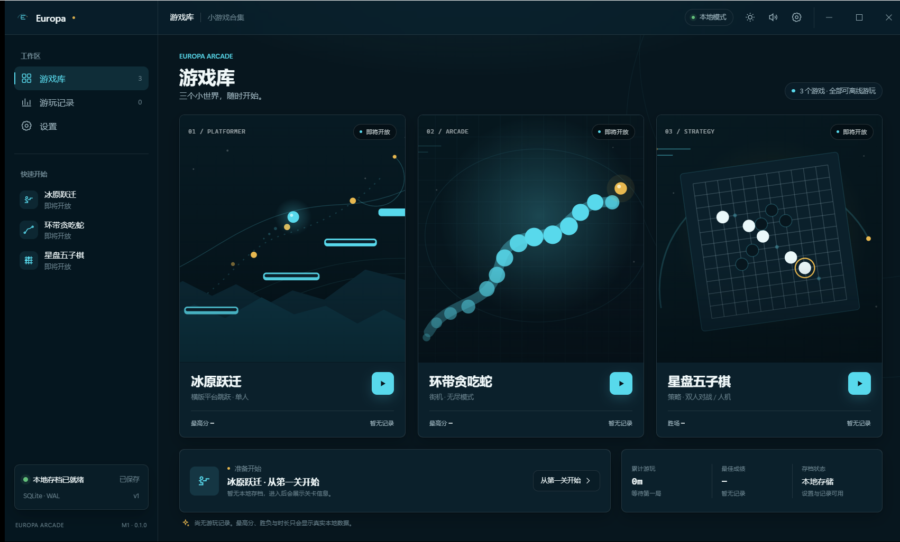
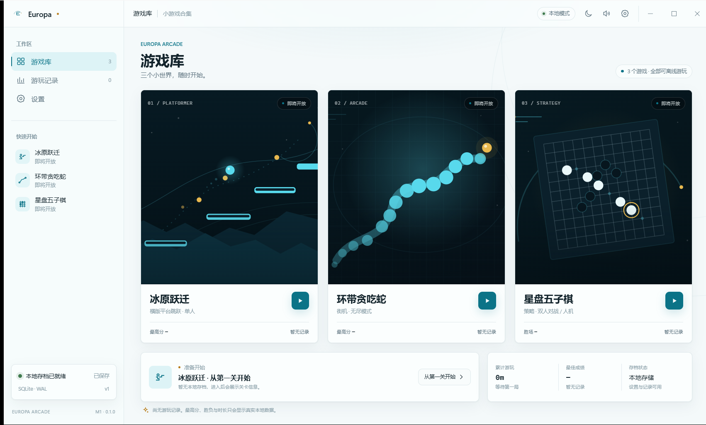
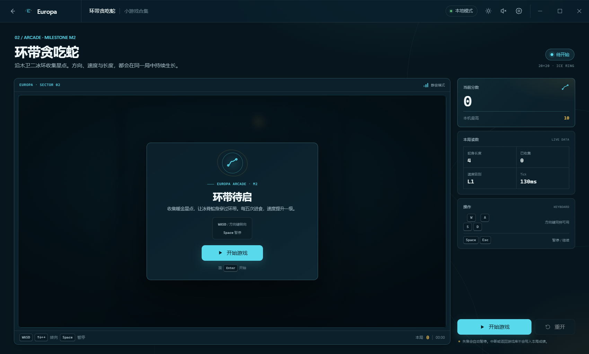
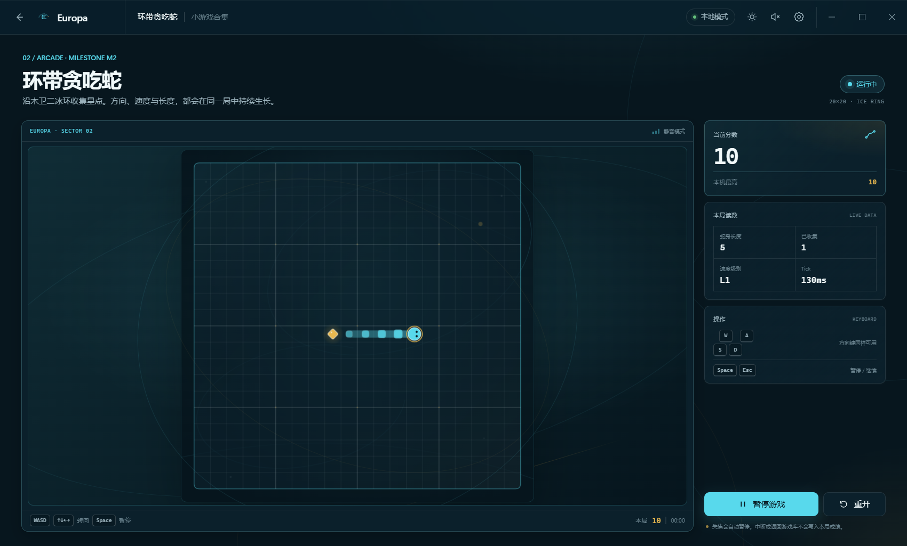
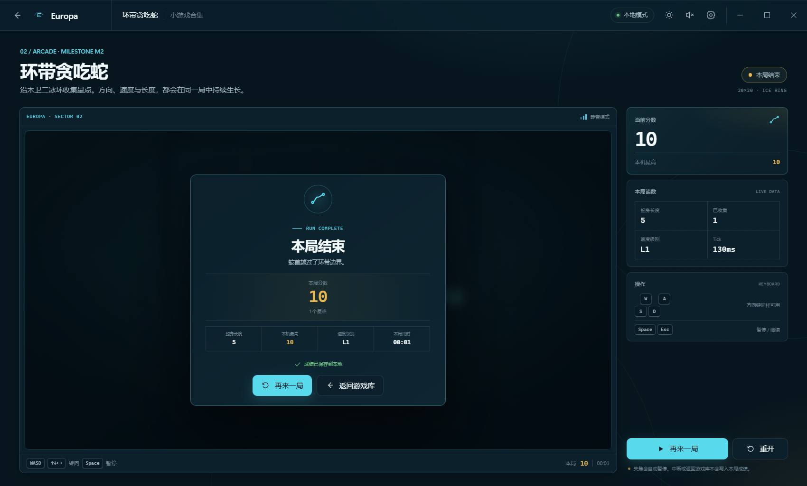
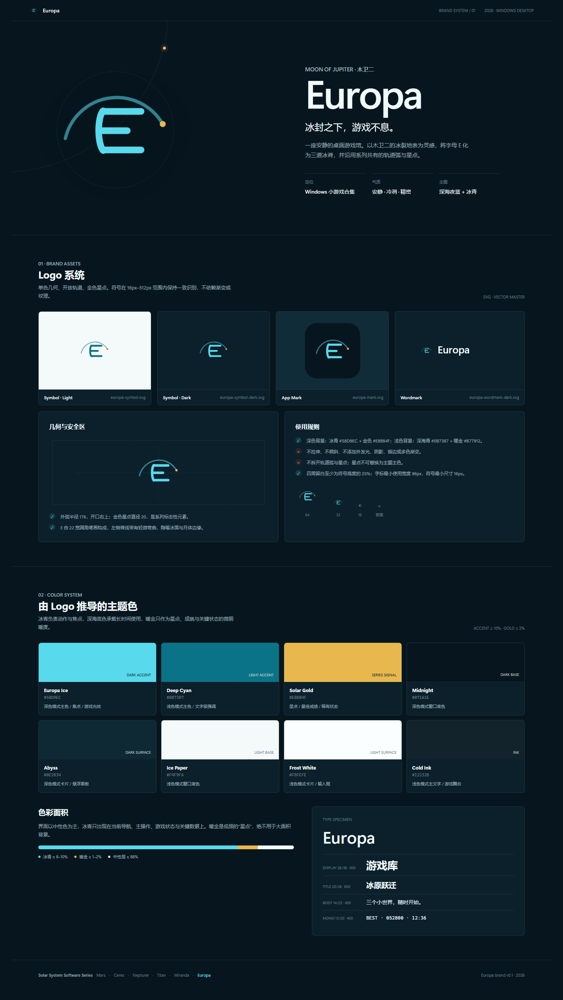

# Europa · 木卫二小游戏合集

> Windows 桌面端小游戏合集，太阳系软件系列成员：Mars · Ceres · Neptune · Titan · Miranda · Europa

**当前状态：v1.1.3 已发布：冰原跃迁六关背景与场景全面升级——雪山山脊、针叶林、雪丘、雾带、浪尖碎沫、明月倒影、荧光晶簇、星云雾团与能量丝线等程序化丰富背景，各关地貌更有层次；冰原跃迁现有 1–6 关、三倍关卡长度、武器系统与多类敌人，三款小游戏均可完整游玩；自动更新、NSIS 打包与 GitHub Release 发布已就绪。**

## M1–M3 已完成

- Tauri 2 + React 19 + TypeScript + Vite 工程骨架。
- 1360×820 无边框 Windows 窗口，最小尺寸 1040×700，自定义拖动、最小化、最大化与关闭。
- Europa 深/浅主题、系统主题跟随、减少动态与音效开关。
- 游戏库、游玩记录、设置与 Hash 路由；环带贪吃蛇为完整可玩页，冰原跃迁与星盘五子棋保留明确占位页。
- Rust IPC：`load_bootstrap`、`save_setting`、`submit_snake_match`。
- SQLite v2 迁移框架，启用 WAL、外键与 5 秒 busy timeout；v1 数据库会备份为 `europa.db.bak-v1` 后原地升级。
- 浏览器预览降级：使用 `localStorage`，并明确显示“浏览器预览模式”。
- Vitest + Testing Library 测试基础，以及 Windows GitHub Actions CI。
- 所有成绩、胜负与时长均使用真实数据；空数据统一显示“暂无记录”“—”“0”或“从第一关开始”。
- 环带贪吃蛇：20×20 棋盘、初始长度 4、食物 +10、每 5 个食物提速 8ms、最快 65ms、填满棋盘额外 +500。
- 完整状态机：Ready → 1 秒 Countdown → Playing ↔ Paused → Result；支持 WASD/方向键、Enter、Space/Esc、失焦自动暂停与同会话失败重试。
- Canvas 2D 棋盘、HUD、暂停/结果覆盖层与 1040×700 最小窗口响应式布局；冰青蛇身与暖金食物延续 Europa 主题。
- `submit_snake_match` 以 `session_id` 幂等提交，统计与比赛历史在同一 SQLite 事务中写入；浏览器预览使用独立本地账本。
- Vitest 9 个测试文件、52 项测试，以及 Rust 11 项测试；M2 版本标签为 `M2 · 0.1.0`。

### M3 冰原跃迁

- 冰原跃迁：6 个手工关卡（初醒冰原 / 裂隙回廊 / 潮汐之眼 / 永夜冰脊 / 静默冰层 / 欧罗巴之心）、固定 60Hz 固定步长引擎、土狼时间/跳跃缓冲/可变跳跃、水晶/轨道哨兵/检查点/信标与 3 条生命。
- 状态机：Ready → 1.2s 关卡导览 → Playing ↔ Paused → Complete/GameOver/Victory → Result；Esc 暂停、失焦/隐藏自动暂停、检查点存档与未完成卸载仅存档不结算。
- 新增 Rust IPC：`load_platformer_checkpoint`、`save_platformer_checkpoint`、`clear_platformer_checkpoint`、`submit_platformer_match`；检查点按槽位 upsert 至 `platformer_saves`，结算按 `session_id` 幂等写入 `match_history` 与 `game_stats`。
- 浏览器预览新增 `europa.browser-platformer-save` 与 `europa.browser-platformer-ledger` 降级存储。
- 当前测试：前端 13 个测试文件、82 项测试，Rust 16 项测试；M3 版本标签为 `M3 · 0.1.0`。

## 快速启动

环境要求：

- Windows 10/11 x64；
- Node.js 24；
- Rust stable 与 Microsoft C++ Build Tools；
- WebView2 Runtime（Windows 10/11 通常已预装）。

安装依赖并启动桌面端：

```powershell
npm ci
npm run tauri dev
```

仅预览前端：

```powershell
npm run dev
```

浏览器打开 `http://localhost:1430/?theme=dark#/library`。浏览器模式不会写入 SQLite。Europa 开发端口固定为 1430，可与常见的 1420 端口实例并行运行。

生成 Windows 安装包：

```powershell
npm run tauri build
```

生成更新清单（构建完成后执行，产物在 `src-tauri/target/release/bundle/latest.json`）：

```powershell
npm run update:manifest
```

发布时需将 `latest.json` 与 NSIS 安装包上传为 GitHub Release 附件（tag 形如 `v1.0.0`），并在 Release 中重命名 `latest.json` 后即可由应用内“设置 → 关于与更新”自动发现并安装更新。

## 本地数据

桌面端数据库路径：

```text
%APPDATA%\com.europa.desktop\Europa\europa.db
```

首次启动自动创建并迁移至 schema v2。v2 在 `match_history` 上新增可为空的 `session_id`，并以唯一索引保证同一对局只记录一次；v1 升级前会生成 `europa.db.bak-v1`。当前表结构：

| 表                 | 用途                               |
| ------------------ | ---------------------------------- |
| `settings`         | 主题、音效、减少动态等设置         |
| `game_stats`       | 各游戏最高分、局数、胜负与累计时长 |
| `platformer_saves` | 冰原跃迁检查点存档                 |
| `match_history`    | 对局历史                           |

M1 接通设置读写和启动数据读取；M2 已接通环带贪吃蛇的统计与比赛历史原子写入；M3 已接通冰原跃迁的检查点存档与幂等结算。五子棋结果 API 留到 M4。

浏览器预览设置保存在 `localStorage` 的 `europa.browser-settings` 键中；环带贪吃蛇统计与会话账本保存在 `europa.browser-snake-ledger`；冰原跃迁检查点与账本分别保存在 `europa.browser-platformer-save` 与 `europa.browser-platformer-ledger`。浏览器模式 schema 显示为 v0，不写入 SQLite。

## 质量检查

```powershell
npm run typecheck
npm run lint
npm run test:run
npm run build
cargo fmt --manifest-path src-tauri/Cargo.toml -- --check
cargo test --manifest-path src-tauri/Cargo.toml --locked
cargo check --manifest-path src-tauri/Cargo.toml --locked
```

CI 配置位于 `.github/workflows/ci.yml`，在 Windows runner 上执行以上前端与 Rust 检查。

## M1 桌面端实机界面

### 深色主题



### 浅色主题



## M2 桌面端实机界面

以下截图均来自 Tauri 2 Release 在 WebView2 中的实际运行，最高分与对局数据直接来自本地 SQLite。

### 准备开始



### 对局中 · 实际得分 10



### 本局结束 · 已持久化



## 里程碑

| 里程碑 | 范围                                        | 状态   |
| ------ | ------------------------------------------- | ------ |
| M0     | Logo、UI 规范、品牌资产与设计文档           | 已完成 |
| M1     | Tauri 骨架、设计系统、应用壳层、SQLite 基础 | 已完成 |
| M2     | 环带贪吃蛇完整玩法、幂等结算与 schema v2     | 已完成 |
| M3     | 冰原跃迁完整玩法、检查点与幂等结算         | 已完成 |
| M4     | 星盘五子棋完整玩法                          | 已完成 |
| M5     | 设置、音频、记录与本地化                    | 已完成 |
| M6     | 稳定性、性能与可访问性                     | 已完成 |
| M7     | 自动更新、打包与发布                        | 已完成 |

## 设计与规划文档

| 类型               | 文件                           |
| ------------------ | ------------------------------ |
| Logo 设计方案      | `design/logo-design.md`        |
| UI 风格与主题规范  | `design/ui-design-system.md`   |
| 开发流程与技术方案 | `docs/开发流程与技术方案.md`   |
| 三个小游戏设计文档 | `docs/小游戏设计文档.md`       |
| 品牌板             | `assets/brand/brand-board.png` |

### 品牌概览

- **Logo 概念**：冰脊 E。E 的四条笔画隐喻木卫二冰壳脊线，上方弧线代表轨道，暖金星点延续太阳系软件系列的节点语言。
- **主题色**：Europa Ice `#58D9EC`、Deep Cyan `#0B7387`、Solar Gold `#E8B84F`、Midnight `#07161E`、Ice Paper `#F4F9FA`。
- **口号**：冰封之下，游戏不息。
- **设计关键词**：冰封、轨道、精密、安静。



## 目录

```text
Euorpa/
├─ .github/workflows/      # Windows CI
├─ assets/brand/           # Logo 与应用图标
├─ design/                 # Logo/UI 规范与预览
├─ docs/                   # 开发计划与游戏设计
├─ src/                    # React 应用壳层与测试
├─ src-tauri/              # Tauri/Rust/SQLite
└─ README.md
```
