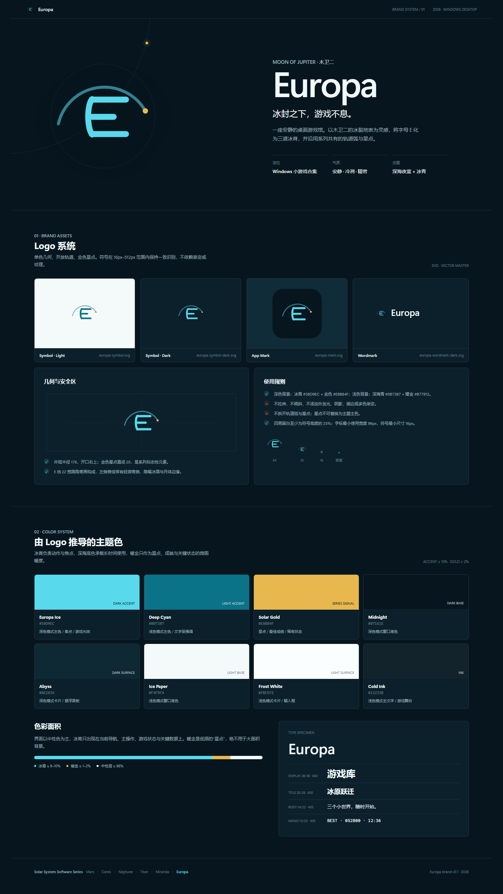

# Europa Logo 设计方案

> 项目：Europa（木卫二） Windows 桌面端小游戏合集  
> 系列：Mars / Ceres / Neptune / Titan / Miranda / Europa  
> 版本：v0.1 · 第一阶段  
> 状态：设计定稿，可用于 UI 与后续开发  
> 日期：2026-11-07



## 1. 设计目标

Europa 的 Logo 需要同时回答三个问题：

1. **一眼可识别**：在 16px 的窗口图标尺寸下仍能看出字母 E 与轨道关系。
2. **名称有来源**：与木卫二 Europa 的冰壳、冰裂、轨道和深空意象建立联系，而不是套用通用星球图标。
3. **系列可归队**：与 Mars、Ceres、Neptune、Titan、Miranda 的单色几何、弧线、圆点、克制留白一脉相承，同时拥有独立的冰青识别。

最终采用的方案名为 **“冰脊 E”（Ice Ridge E）**。

## 2. 概念叙事

Europa 是木星的一颗冰质卫星。它的表面覆盖着纵横交错的冰脊与裂缝，内部可能存在深海。Logo 不直接绘制星球，而是把这两个事实压缩成一个字母：

- **E 的四条笔画**：对应冰壳上的平行脊线，也构成 Europa 的首字母。
- **左侧竖画的轻微弯曲**：暗示星体边缘与冰面起伏；它不是机械的直线，也不是装饰性的波浪。
- **上方长弧**：代表木卫二环绕木星的轨道，并延续太阳系软件系列的“弧线 + 节点”语言。
- **暖金星点**：落在轨道尽头上，代表木星、航行中的目标，或一次游戏开始前的信号。它是整套冷色视觉中唯一稳定的暖色锚点。
- **大面积的负空间**：让标志在深色舞台、浅色纸面和 Windows 任务栏中都保持安静，不抢占游戏内容。

品牌口号：

> **冰封之下，游戏不息。**

它对应“冰壳之下是海洋”，也对应小游戏合集在安静桌面环境中的持续可玩性。

## 3. 几何构成

### 3.1 基础画布

| 属性 | 规范 |
| --- | --- |
| 画布 | `512 × 512` |
| 主笔画 | `22px` 圆角描边 |
| 轨道线 | `11px` 圆角描边，`55%` 不透明度 |
| 星点 | 半径 `10px` 的实心圆 |
| 主色 | 冰青 `#58D9EC` |
| 星点色 | 暖金 `#E8B84F` |
| 矢量格式 | SVG，保留路径与精确坐标 |

### 3.2 核心路径

```svg
<path d="M 90 284 A 176 176 0 0 1 414 236"
      fill="none" stroke="#58D9EC" stroke-width="11"
      stroke-linecap="round" opacity="0.55"/>
<circle cx="414" cy="236" r="10" fill="#E8B84F"/>
<g fill="none" stroke="#58D9EC" stroke-linecap="round" stroke-width="22">
  <path d="M 216 192 C 196 212 196 300 216 324"/>
  <path d="M 214 194 L 342 194"/>
  <path d="M 214 258 L 296 258"/>
  <path d="M 214 322 L 342 322"/>
</g>
```

### 3.3 构成关系

- **E 是主体，轨道是语境**。任何变体中，E 都应先于轨道被识别。
- 轨道从左侧低位升起，在右上角落入星点，形成从左下到右上的轻微动势。
- 四条笔画不追求严格等长：中横画较短，制造呼吸；上、下横画与弧线保持视觉平衡。
- 左侧竖画的弯曲幅度控制在约 `20px`，保证在 16px 渲染时仍像直线，不会退化为噪点。
- 星点与 E 最低点、轨道起点的关系保持固定，不允许为了“构图好看”而随意移动。

## 4. 同系列关系

Europa 不复制其他项目的图形，但继承相同的品牌语法：

| 设计维度 | 系列共同语言 | Europa 的差异化 |
| --- | --- | --- |
| 图形 | 单一几何符号，少量弧线与节点 | “E”字形冰脊 |
| 色彩 | 一个项目主色 + 中性色 + 极小面积暖色 | 冰青 `#58D9EC` + 暖金 |
| 材质 | 平面矢量，不使用照片、渐变球体 | 深海底色与冰青线稿 |
| 排版 | 大留白、零字距、Segoe UI Variable | 保持相同字标栈与字重 |
| 动效 | 低调、可中断、服务操作 | 星点呼吸与轨道扫光仅用于启动/加载 |
| 结构 | 左符号、右字标；应用图标为圆角方块 | 继续沿用 232px 侧栏、52px 顶栏 |

同系列项目各有独立的行星色，但共同的“单色几何 + 圆点”让它们仍然像一套软件。Europa 的识别锚点是 **冰青 + 暖金 + 双弧感 E**。

## 5. 色彩推导

Logo 到 UI 主题的推导关系如下：

| 品牌层 | 色值 | UI 角色 |
| --- | --- | --- |
| 冰青 | `#58D9EC` | 深色模式主操作、焦点、游戏光效 |
| 深海青 | `#0B7387` | 浅色模式主操作与文字级强调 |
| 暖金 | `#E8B84F` | 星点、最高分、稀有状态、关键数据 |
| 深海底 | `#07161E` | 深色窗口底色与游戏舞台基底 |
| 冰纸 | `#F4F9FA` | 浅色模式窗口底色 |
| 冷墨 | `#12232B` | 浅色模式主文字 |
| 霜白 | `#FBFEFE` | 浅色模式卡片与面板 |

配色原则：

- 冰青是**动作色**，用于“开始、继续、当前选中、正在运行”。
- 暖金是**成就色**，只用于最高分、星点、胜利或稀有状态，面积不超过屏幕的 2%。
- 深海底与冰纸是**环境色**，承担 88% 以上的面积。
- 浅色模式不使用 `#58D9EC` 作为小字强调，改用 `#0B7387`；浅色模式暖金使用 `#B77912`。
- Logo 不使用渐变、金属质感、发光晕圈或第三种装饰色。

## 6. 资产与变体

| 文件 | 用途 | 背景 |
| --- | --- | --- |
| `assets/brand/europa-symbol.svg` | 透明符号，浅色背景 | 冰纸、白色 |
| `assets/brand/europa-symbol-dark.svg` | 透明符号，深色背景 | 深海、深灰 |
| `assets/brand/europa-wordmark.svg` | 横版“符号 + Europa” | 浅色 |
| `assets/brand/europa-wordmark-dark.svg` | 横版“符号 + Europa” | 深色 |
| `assets/brand/europa-mark.svg` | 1024px 圆角应用图标 | 深海底 |
| `assets/brand/brand-board.html` | 可编辑品牌板 | 浏览器预览 |
| `assets/brand/brand-board.png` | 品牌板导出图 | 交付预览 |
| `design/ui-style-preview.html` | 品牌应用后的 UI 预览 | 深/浅主题 |

### 6.1 应用图标

- 画布：`1024 × 1024`
- 圆角半径：`224px`，即边长的 `21.875%`
- 内层符号缩放：`1.8×`，视觉居中
- 背景：`#07161E`
- 图标内轨道弧为 `#58D9EC / 55%`，E 为 `#58D9EC`，星点为 `#E8B84F`
- Windows 安装包应至少生成 `16 / 20 / 24 / 32 / 40 / 48 / 64 / 128 / 256 / 512 / 1024` 像素的 ICO/PNG 集

### 6.2 横版字标

- 画布：`384 × 96`
- 符号高度：约 `48px`
- 字标字体：`Segoe UI Variable Display / Segoe UI / Inter`
- 字重：`600`
- 字距：`0`
- 深色版文字：`#F0F8FA`
- 浅色版文字：`#12232B`

## 7. 最小尺寸与安全区

### 7.1 最小尺寸

| 载体 | 最小尺寸 |
| --- | --- |
| 透明符号 | `16 × 16px` |
| 横版字标 | 高 `24px`（建议宽 `96px` 以上） |
| 应用图标 | `16px`；正式安装器使用 `256px` 以上母版 |
| 启动画面 | 符号不低于 `64px` |
| 侧栏 / 顶栏 | 符号 `20–24px` |

在 16px 下只使用透明符号，不使用横版字标；星点可保留，但轨道线需以实际渲染结果为准做像素对齐检查。

### 7.2 安全区

- 符号四周留白至少为可见符号高度的 `25%`。
- 横版字标四周留白至少为字标高度的 `25%`。
- 不允许文字、边框、游戏卡图或其他图标进入安全区。
- 应用图标内部符号不贴边；圆角外轮廓本身承担系统图标的边界。

## 8. 使用规则

### 正确

- 使用 SVG 母版，按比例缩放。
- 深色底使用 dark 变体，浅色底使用 light 变体。
- 侧栏只使用符号，启动画面使用字标，Windows 外壳使用应用图标。
- 星点保持在轨道终点，不额外复制星点。
- 需要强调时只增加少量外发光，不改变笔画颜色。

### 错误

- 不使用“星球照片”“木星纹理”“渐变球体”替代符号。
- 不拉伸、不压扁、不旋转整个 E。
- 不改变笔画宽度，不把 E 改为细体字。
- 不加描边外框、阴影底板或彩色渐变。
- 不把星点放大成大圆，不把轨道改为完整圆环。
- 不在低对比度背景上使用同色变体。
- 不把 Logo 用作游戏内可收集物、按钮图标或装饰贴纸的重复图案。

## 9. 无障碍与可读性

- SVG 必须带 `role="img"` 与可读的 `aria-label`，装饰性副本使用空 `alt`。
- 文字与背景对比度满足正文 `4.5:1`、大字号 `3:1` 的目标。
- 关键状态不能只依赖冰青/暖金；必须同时有文字、图标或形状变化。
- 开启 `prefers-reduced-motion` 时禁止 Logo 长时间循环动效。
- 在高 DPI 屏幕上使用矢量或 2× 位图，不使用 1× PNG 放大。

## 10. 验收标准

- [x] 512px 母版下 E、轨道、星点关系稳定。
- [x] 16px 下仍可识别为 E，不出现笔画粘连。
- [x] 深色与浅色背景均有对应变体。
- [x] 色彩与 UI 令牌同源。
- [x] 符号与字标、应用图标三种形态一致。
- [x] 与系列项目的几何语言一致，且能通过冰青与“冰脊 E”区分。
- [x] 所有资产为原创矢量，不依赖外部字体图片或第三方商标。
