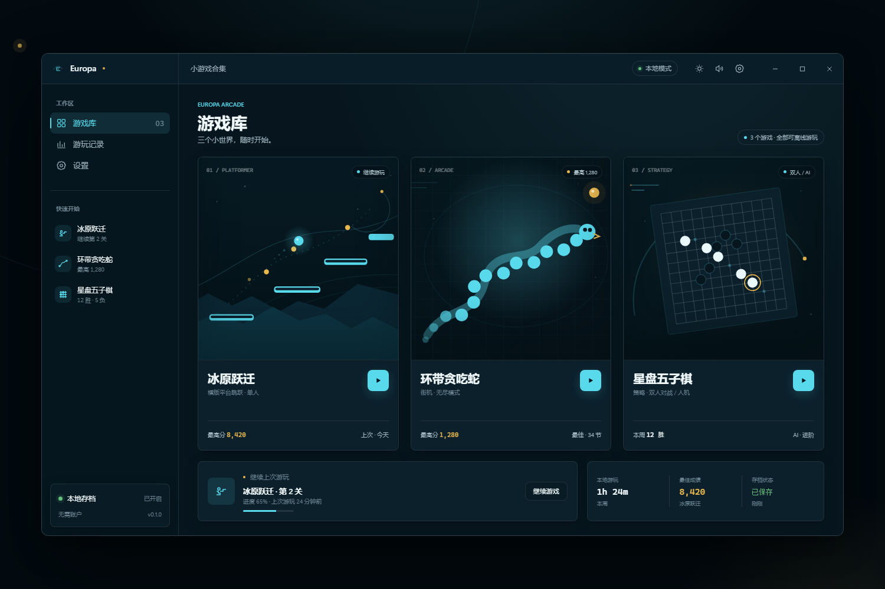
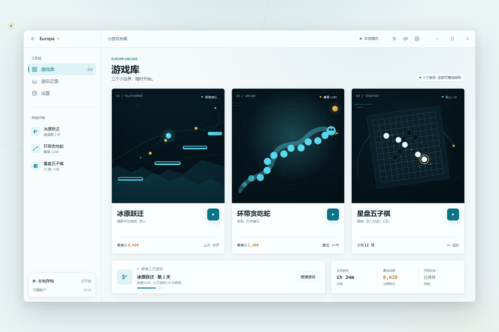

# Europa UI 风格与主题规范

> 项目：Europa Windows 桌面端小游戏合集  
> 版本：v0.1 · 第一阶段  
> 状态：视觉规范定稿，可作为后续 React/Tauri 实现的唯一 UI 依据  
> 日期：2026-11-07

## 1. 视觉预览

### 深色主题



### 浅色主题



预览源文件：`design/ui-style-preview.html`。深、浅主题共用同一套组件与布局，仅替换语义令牌。

## 2. 设计定位

Europa 的关键词是 **冰封、轨道、精密、安静**。界面不是传统游戏启动器的霓虹风格，而是一张克制的深空工作台：游戏内容作为“舞台”出现，其余区域退居中性色。

### 2.1 设计原则

1. **安静高级**：不使用营销 Banner、夸张描边、满屏发光和装饰性插画；层级由字体、留白、材质与少量冰青完成。
2. **内容即舞台**：游戏卡图与游戏画面可以更暗、更具氛围；应用外壳保持干净，避免和游戏争夺注意力。
3. **系列一致性**：沿用 232px 侧栏、52px 顶栏、4pt 网格、8px 卡片圆角、Segoe UI Variable、玻璃顶栏与低面积强调色。
4. **动作色与成就色分离**：冰青负责开始、继续、选中和运行；暖金只负责最高分、胜利、星点等低频成就信息。
5. **即时反馈**：按压反馈在 100ms 内出现；所有暂停、返回、重开动作都有稳定状态，不依赖长动画。
6. **本地优先**：不登录、不云同步；设置、最高分和存档默认仅保存在本机。

## 3. 色彩系统

### 3.1 语义令牌

| Token | 浅色模式 | 深色模式 | 用途 |
| --- | --- | --- | --- |
| `--bg` | `#F4F9FA` | `#07161E` | 窗口底色 |
| `--bg-raised` | `#FBFEFE` | `#0B202B` | 卡片、面板、侧栏实体底 |
| `--surface-glass` | `rgba(251,254,254,0.74)` | `rgba(11,32,43,0.70)` | 顶栏、玻璃浮层 |
| `--sidebar` | `rgba(248,252,253,0.78)` | `rgba(7,22,30,0.72)` | 侧栏玻璃 |
| `--text` | `#12232B` | `#F1F9FA` | 主文字 |
| `--text-2` | `#5E7480` | `#9DB4BE` | 次级文字、说明 |
| `--text-3` | `#8BA0A9` | `#68818C` | 时间戳、禁用、辅助标签 |
| `--line` | `#DFE9EC` | `rgba(241,249,250,0.10)` | 分隔线、常规边框 |
| `--line-strong` | `#C8D6DA` | `rgba(241,249,250,0.18)` | 强边框、窗口轮廓 |
| `--accent` | `#0B7387` | `#58D9EC` | 主操作、选中、焦点、运行状态 |
| `--accent-ink` | `#0B7387` | `#58D9EC` | 文字级强调 |
| `--accent-soft` | `#DDF3F6` | `rgba(88,217,236,0.12)` | 选中底、标签底、轻提示 |
| `--accent-contrast` | `#FBFEFE` | `#07161E` | 主色按钮上的文字/图标 |
| `--gold` | `#B77912` | `#E8B84F` | 星点、最高分、胜利、稀有状态 |
| `--gold-soft` | `rgba(183,121,18,0.10)` | `rgba(232,184,79,0.12)` | 金色状态的浅底 |
| `--success` | `#3F7A4E` | `#63BF7B` | 完成、已保存、健康状态 |
| `--danger` | `#B3372B` | `#E4624F` | 错误、删除、结束失败 |
| `--warning` | `#B77912` | `#E8B84F` | 不确定状态、需要注意 |
| `--stage` | `#EAF3F4` | `#030B10` | 应用内容舞台背景 |
| `--art-stage` | `#06151D` | `#06151D` | 游戏卡图与游戏画面的深色底 |
| `--focus` | `#0B7387` | `#58D9EC` | 键盘焦点环 |
| `--highlight` | `rgba(255,255,255,0.60)` | `rgba(241,249,250,0.10)` | 玻璃顶部 1px 高光 |

### 3.2 面积与使用规则

- 中性色承担约 **88%** 的视觉面积。
- 冰青约占 **8–10%**，只用于当前导航、主按钮、游戏状态、焦点环与关键图形。
- 暖金不超过 **1–2%**，只用于最高分、星点、胜利与稀有提示。
- 成功/警告/危险色只表达状态，不作为品牌装饰色。
- 浅色模式下，小字号冰青文字一律使用 `--accent-ink`；深色模式下可使用 `--accent`。
- 浅色模式下暖金正文与小字使用 `#B77912`，不使用高亮 `#E8B84F`。
- 不允许整块冰青背景、渐变主按钮或彩色玻璃。

### 3.3 对比度基线

| 前景 / 背景 | 对比度 | 结论 |
| --- | --- | --- |
| `#58D9EC / #07161E` | 10.99:1 | 深色模式主色可用 |
| `#0B7387 / #F4F9FA` | 5.18:1 | 浅色模式主色可用 |
| `#E8B84F / #07161E` | 9.98:1 | 深色模式金色可用 |
| `#5E7480 / #F4F9FA` | 4.61:1 | 浅色模式次级文字可用 |
| `#F1F9FA / #07161E` | > 15:1 | 深色模式主文字可用 |

游戏内文字和 HUD 需在深色舞台背景上单独验证，不以应用外壳的对比度代替。

## 4. 字体与排版

### 4.1 字体栈

```css
--font-ui: "Segoe UI Variable Display", "Segoe UI", Inter, "Microsoft YaHei UI", sans-serif;
--font-mono: "Cascadia Mono", "SFMono-Regular", Consolas, monospace;
```

### 4.2 字号体系

| 样式 | 字号/行高 | 字重 | 用途 |
| --- | --- | --- | --- |
| Hero | 40/48 | 600 | 启动页、结果页大标题 |
| Display | 28/36 | 600 | 页面标题 |
| Title | 20/28 | 600 | 游戏名、区块标题 |
| Heading | 16/24 | 600 | 面板、设置分组 |
| Body | 14/22 | 400 | 正文、表单、列表 |
| Small | 12/18 | 400 | 说明、标签、状态 |
| Caption | 11/16 | 400 | 时间戳、角标 |
| Mono | 13/20 | 400 | 分数、计时、统计数据 |

规则：

- 字母间距恒为 `0`，不使用大字距作为“科技感”。
- 正文行高不小于 `1.5`；最小可读正文为 `12px`。
- 数字启用 `font-variant-numeric: tabular-nums`，避免得分和倒计时抖动。
- 中文正文优先使用 Segoe UI Variable 的中文回退微软雅黑 UI；不混用第三方展示字体。
- 标题不使用全大写英文装饰，仅区块标签可使用 11px 大写英文。

## 5. 网格、尺寸与层级

### 5.1 空间网格

4pt 基础网格：`4 / 8 / 12 / 16 / 20 / 24 / 32 / 48 / 64`。

| 项目 | 规范 |
| --- | --- |
| 默认窗口 | `1360 × 820px` |
| 最小窗口 | `1040 × 700px` |
| 顶栏 | `52px` |
| 侧栏 | `232px` |
| 内容区左右内边距 | `32px` |
| 内容区底部内边距 | `24px` |
| 游戏卡横向间距 | `20px` |
| 页面区块间距 | `24–32px` |
| 常规卡片内边距 | `16px` |
| 列表行高 | `44px` |
| 输入控件高度 | `36px` |
| 主要按钮高度 | `36px` |
| 图标按钮 | `32 × 32px`，热区至少 `44 × 44px` |

### 5.2 圆角

- 应用窗口：`12px`
- 卡片、按钮、输入框、导航选中态：`8px`
- 弹窗：`12px`
- 标签、状态胶囊、进度条：`999px`
- 应用图标：`224 / 1024 ≈ 21.875%`

### 5.3 阴影与玻璃

```css
--shadow-1: 0 1px 2px rgba(18,35,43,.05), 0 8px 24px rgba(18,35,43,.06);
--shadow-2: 0 10px 30px rgba(18,35,43,.10), 0 36px 90px rgba(18,35,43,.14);
--glass: backdrop-filter: blur(20px) saturate(160%);
--glass-strong: backdrop-filter: blur(24px) saturate(180%);
```

- 深色模式阴影使用黑色半透明。
- 玻璃层必须有 1px 顶部高光，避免变成模糊的灰色块。
- 低性能设备或 `prefers-reduced-transparency` 时取消 `backdrop-filter`，将底色不透明度提高到 `0.96`。

## 6. 应用框架

```text
┌──────────────────────────────────────────────────────────────────┐
│ 52px 顶栏：品牌区 232px | 当前页面 | 本地模式 | 主题/音效/设置 | 窗口控制 │
├──────────────┬───────────────────────────────────────────────────┤
│ 232px 侧栏   │ 内容区：32px padding                               │
│ 工作区导航   │ 标题区 → 游戏卡网格 → 继续游玩 → 统计              │
│ 快速开始     │                                                   │
│ 本地存档卡   │                                                   │
└──────────────┴───────────────────────────────────────────────────┘
```

### 6.1 顶栏

- 高度 `52px`，玻璃 + `border-bottom: 1px solid var(--line)`。
- 左侧品牌区宽度固定 `232px`，与侧栏对齐，放置 22px 符号与 `Europa` 字标。
- 中间显示当前页面名“小游戏合集”；右侧显示“本地模式”状态、主题、音效、设置。
- 最右侧是自定义窗口控制：最小化、最大化、关闭，每个按钮宽约 `46px`。
- 顶栏空白区域可拖动窗口，双击可最大化；按钮区域不参与拖动。
- 窗口关闭时若游戏处于暂停或运行中，先保存必要存档，再退出。

### 6.2 侧栏

- 宽度 `232px`，玻璃或 `--bg-raised` 底；与内容区之间使用 1px 分隔线。
- 上部为“工作区”：游戏库、游玩记录、设置。
- 中部为“快速开始”：三个小游戏入口与简短状态。
- 底部为本地存档状态卡：绿色状态点、存档开关、版本号。
- 导航项高度 `36px`，圆角 `8px`，图标 `18px`，文字 `14px`。
- 选中态使用 `--accent-soft` 底、左侧 `3px` 冰青条、文字为 `--text`。
- 不把侧栏塞满图标或游戏分类；第一阶段只保留必要入口。

### 6.3 内容区

- 所有页面使用同一 32px 外边距与弹性纵向布局。
- 页面标题区由 11px 英文标签、28px 中文标题、12px 说明组成。
- 右侧可放一个低强调的状态胶囊，不重复页面标题。
- 内容超出高度时只滚动内容区，顶栏与侧栏保持固定。

## 7. 游戏库首页

### 7.1 顶部信息

- 标签：`EUROPA ARCADE`
- 主标题：`游戏库`
- 说明：`三个小世界，随时开始。`
- 右侧胶囊：`3 个游戏 · 全部可离线游玩`

标题不使用副标题长句，不使用“欢迎回来”之类账号化文案，因为应用不登录。

### 7.2 游戏卡

卡片按固定顺序排列：

1. `冰原跃迁` — 横版平台跳跃
2. `环带贪吃蛇` — 街机 / 无尽模式
3. `星盘五子棋` — 策略 / 双人 / AI

结构：

- 上部为深色游戏卡图，保持统一 `--art-stage` 底和 8px 外圆角。
- 卡图内最多显示一个游戏状态胶囊，如“继续游玩”“最高分 1,280”“双人 / AI”。
- 中部左为 20px 游戏名与 12px 类型说明，右为 40px 圆形开始按钮。
- 底部为 11px 统计行：最高分 / 本周胜负 / 上次游玩。
- 卡片整体高度一致，不因文字长度变化。
- Hover 上移 `2px` 并加强边框；按下 `scale(.987)`；不播放持续光效。
- 点击整张卡与点击开始按钮等效。

卡图规则：

- 只使用深海背景、冰青线面、少量暖金节点。
- 每张卡有一个可识别的中心图形：平台与跳跃轨迹、环形蛇身、倾斜棋盘点。
- 不使用写实截图、通用游戏手柄图标、素材站剪贴画。
- 卡图内不重复放产品 Logo 或大段说明文字。

### 7.3 继续游玩与统计

- 继续游玩卡占约 `60%` 宽，显示游戏名、关卡、进度条和“继续游戏”。
- 统计卡占约 `40%` 宽，内部三等分：本周游玩时长、最佳成绩、存档状态。
- 三列之间用 1px 分隔线，不上底色，不使用三张独立卡片。
- 数字使用 Mono 样式，单位使用 Small 样式；暖金只用于“最佳成绩”数字。

### 7.4 空态

- 使用符号、1 行说明和 1 个主操作。
- 空态不使用插画大面积占位，不展示未实现的功能。
- 首次启动时，成熟存档不存在，继续游玩位显示“从第一关开始”。

## 8. 游戏运行界面

进入游戏后隐藏完整侧栏，只保留 52px 顶栏与沉浸式内容舞台，避免误触切换游戏。顶栏左侧提供返回游戏库按钮，右侧保留暂停、音效和设置。

### 8.1 通用舞台

- 背景：`--art-stage`，叠加极低透明度的轨道弧、星点和网格作为空间线索。
- 可玩区域：保持 16:9 或 1:1 的稳定比例，按窗口缩放，不因内容变化抖动。
- HUD：顶部一条轻玻璃层，显示游戏名、分数/回合、最高分、暂停按钮。
- 状态胶囊：`运行中`、`已暂停`、`AI 思考中` 等文字加状态点，不仅依赖颜色。
- 游戏画面获得焦点时，按 `Esc` 暂停并释放输入；失去窗口焦点时自动暂停。
- 暂停层：舞台压暗 24%，中央 480px 玻璃弹窗，提供继续、重开、返回游戏库。
- 结果层：显示本局成绩、最高分是否刷新、主要统计和“再来一局/返回游戏库”。

### 8.2 各游戏布局

| 游戏 | 主区域 | 辅助区域 | 说明 |
| --- | --- | --- | --- |
| 冰原跃迁 | 16:9 Canvas 平台关卡 | 顶部 HUD | 关卡与角色位于画面中心，背景视差不超过三层 |
| 环带贪吃蛇 | 最大 680×680 的方形棋盘 | 右侧 220px 数据栏或 HUD | 棋盘格线低对比；蛇身、食物、危险方向清晰可辨 |
| 星盘五子棋 | 自适应正方形棋盘 | 右侧 280px 对局面板 | 棋盘优先，回合、难度、悔棋和重开在侧栏内组织 |

### 8.3 HUD 与棋盘视觉

- 分数、步速、生命等关键数字使用等宽数字。
- 游戏内强调色继承冰青，危险状态使用 `--danger`，胜利/最高分才使用暖金。
- 棋盘使用细线、星位与低对比坐标；落子动效不超过 160ms。
- 敌人、障碍、可收集物必须同时具备形状差异，不可仅靠红青区分。
- Canvas 内文字不使用低于 12px 的字号；HUD 文字不得与游戏画面重叠到不可读。
- 游戏结束后保留最后一帧作为背景，并用模糊/压暗层提升结果可读性。

## 9. 组件规范

### 9.1 按钮

| 类型 | 样式 | 用途 |
| --- | --- | --- |
| Primary | 冰青底 + `--accent-contrast` 文字 | 开始、继续、确认 |
| Secondary | `--bg-raised` 底 + 1px 边框 | 取消、返回、重开 |
| Ghost | 透明底，hover `--accent-soft` | 工具、次级操作 |
| Icon | `32×32` 或 `36×36` 固定尺寸 | 主题、音效、设置、暂停 |
| Play | 40px 圆形冰青按钮 | 游戏卡片开始 |

- 主按钮高度 36px，圆角 8px，水平内边距 16px。
- 按下 100ms 内变暗并缩放 `.985`。
- 图标按钮带 tooltip 与 `aria-label`，不依赖图标猜测。
- 破坏性操作（清空存档、删除记录）使用危险色文字 + 确认弹窗。

### 9.2 状态胶囊与标签

- 高度 24px，左右内边距 10px，胶囊圆角。
- 默认使用 `--accent-soft` 底和 `--accent-ink` 文字。
- 金色标签只用于最高分/胜利；成功标签带文字或图标。
- 卡片内一屏最多两个状态胶囊，避免“信息贴纸化”。

### 9.3 分段控件

- 高度 32px，8px 圆角，轨道 `--bg-raised`，选中段 `--accent-soft`。
- 用于音效开关、AI 难度、黑白先后手等二至四选一场景。
- 选中态必须同时改变背景、文字粗细或焦点描边，不能只靠颜色。

### 9.4 弹窗、Toast 与 Tooltip

- 弹窗宽 420–560px，12px 圆角，玻璃层 + `--shadow-2`。
- 标题 20/28，正文 14/22，按钮区右对齐，主操作在右。
- Toast 出现在内容区右下角，宽不超过 360px，显示 3 秒；存档失败等错误不自动消失。
- Tooltip 采用深色实底，12px 字号，延迟 500ms 出现；焦点与悬停均可触发。

### 9.5 进度条、滑杆与开关

- 进度条轨道 4px，圆角 999px，填充冰青。
- 滑杆用于音量；轨道 4px，thumb 16px，数值用等宽数字显示。
- 开关用于“音效”“自动暂停”等持久设置，宽 36px、高 20px，thumb 14px。
- 键盘可操作所有控件；Space 切换开关，方向键调整滑杆。

## 10. 动效与手感

| 场景 | 时长 | 曲线/行为 |
| --- | --- | --- |
| 按钮按下 | 100ms | `scale(.985)` + 背景变暗 |
| 卡片 Hover | 180ms | 上移 2px，边框轻微增强 |
| 页面/面板切换 | 200–300ms | `cubic-bezier(.32,.72,0,1)` |
| 玻璃浮层进入 | 160ms | 淡入 + 上移 4px |
| 暂停/结果层 | 180ms | 压暗 + 缩放从 `.98` 到 `1` |
| 游戏状态提示 | 120–160ms | 淡入淡出，不遮挡操作 |
| 分数变化 | 120ms | 数字淡出/更新/淡入，不逐位滚动 |

- 动画必须可打断，从当前值继续，不使用无法反向的硬切。
- 禁止持续环境光效干扰游戏；卡图可 Static，加载时才有一次轨道扫光。
- `prefers-reduced-motion: reduce` 时关闭位移、缩放与循环动画，仅保留 120ms 淡入淡出。
- 游戏内运动由帧循环驱动，不叠加额外 UI 动画。

## 11. 无障碍

- 正文对比度 ≥ `4.5:1`，大字号/图形 ≥ `3:1`。
- 所有按钮、导航、棋子格和棋盘操作支持键盘：Tab 顺序、Enter/Space 激活、Esc 关闭/暂停。
- 焦点环为 2px 冰青描边，偏移 2px，在明暗主题下均可见。
- 图标按钮必须有 `aria-label`；装饰性卡图使用空 `alt`。
- 游戏状态变化通过 `aria-live="polite"` 播报，包括游戏结束、暂停、落子方、AI 思考中。
- 颜色不是唯一信息通道：危险、胜利、选中状态均配有文字、图标或形状变化。
- 触控目标不小于 44×44px；桌面鼠标目标不小于 32×32px。
- 支持系统高对比度与减少动态效果偏好。

## 12. Windows 与响应式行为

- 目标平台：Windows 10 22H2 / Windows 11，x64。
- 默认窗口 1360×820，最小 1040×700；窗口大小、位置和最大化状态保存到本地。
- 顶栏使用自定义无边框窗口，但保留系统级拖动、双击最大化、最小化/关闭行为。
- 当可用内容宽 ≥ 1200px 时游戏卡三列；低于 1200px 改为两列并允许内容滚动，第三张卡不隐藏。
- 低于最小宽度的异常状态下，侧栏折叠为 72px 图标栏；游戏运行页仍优先保留舞台。
- 支持 100% / 125% / 150% / 200% 缩放；Canvas 按 `devicePixelRatio` 渲染，不出现模糊帧。
- 游戏运行中窗口失焦自动暂停，恢复后显示“已暂停”，避免输入丢失。

## 13. 主题实现规则

```css
:root {
  --bg: #F4F9FA;
  --bg-raised: #FBFEFE;
  --text: #12232B;
  --text-2: #5E7480;
  --accent: #0B7387;
  /* 其余浅色令牌 */
}

[data-theme="dark"] {
  --bg: #07161E;
  --bg-raised: #0B202B;
  --text: #F1F9FA;
  --text-2: #9DB4BE;
  --accent: #58D9EC;
  /* 其余深色令牌 */
}
```

- 根节点通过 `data-theme="light|dark"` 切换主题，首次启动跟随 Windows 系统设置。
- 所有组件只读取语义 Token，不写死十六进制颜色。
- 游戏卡图与游戏舞台始终为深色 `--art-stage`，不随外壳切换为浅色。
- 主题切换不重建页面，不暂停游戏，但应避免在游戏运行时触发大面积重绘。
- 玻璃、阴影和描边均提供无 `backdrop-filter` 的降级版本。
- 游戏 Canvas 的强调色从 CSS Token 读取，确保明暗主题下的 HUD 与外壳一致。

## 14. 视觉验收清单

- [ ] 1360×820 窗口内游戏卡不溢出、不裁切，三卡高度一致。
- [ ] 侧栏、顶部标题、继续游玩卡、统计卡不重叠。
- [ ] 深色与浅色主题的主文字/次级文字对比度达标。
- [ ] 游戏卡图与卡片边界圆角一致，外层不出现白色缝隙。
- [ ] 按钮、导航、卡片的 hover、press、focus 状态均可辨认。
- [ ] 所有图标按钮有 tooltip 与可访问名称。
- [ ] 游戏舞台始终为深色，浅色主题下不出现“白底游戏画面”。
- [ ] 125% 与 150% DPI 下无字体截断、边框错位或画布模糊。
- [ ] 减少动态效果模式下无循环扫光与位移。
- [ ] 键盘可完成进入游戏、暂停、继续、返回和重新开始。
- [ ] 空态、暂停态、结果态、存档失败态均有明确反馈。

## 15. 相关文件

- Logo 方案：`design/logo-design.md`
- Logo 资产：`assets/brand/`
- 品牌板：`assets/brand/brand-board.html`
- 界面源稿：`design/ui-style-preview.html`
- 开发流程：`docs/开发流程与技术方案.md`
- 小游戏设计：`docs/小游戏设计文档.md`
